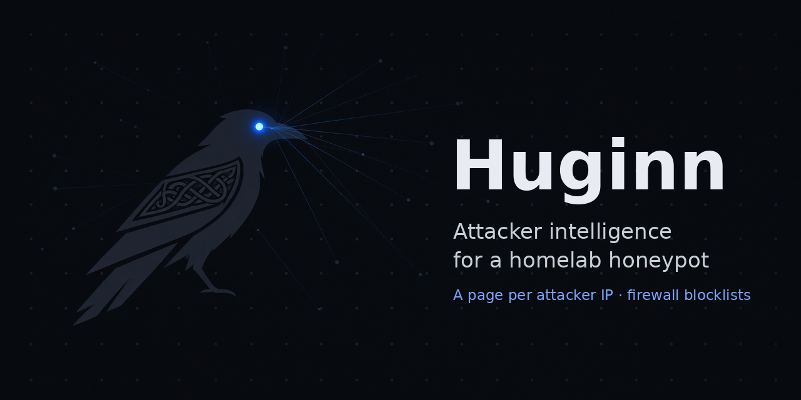
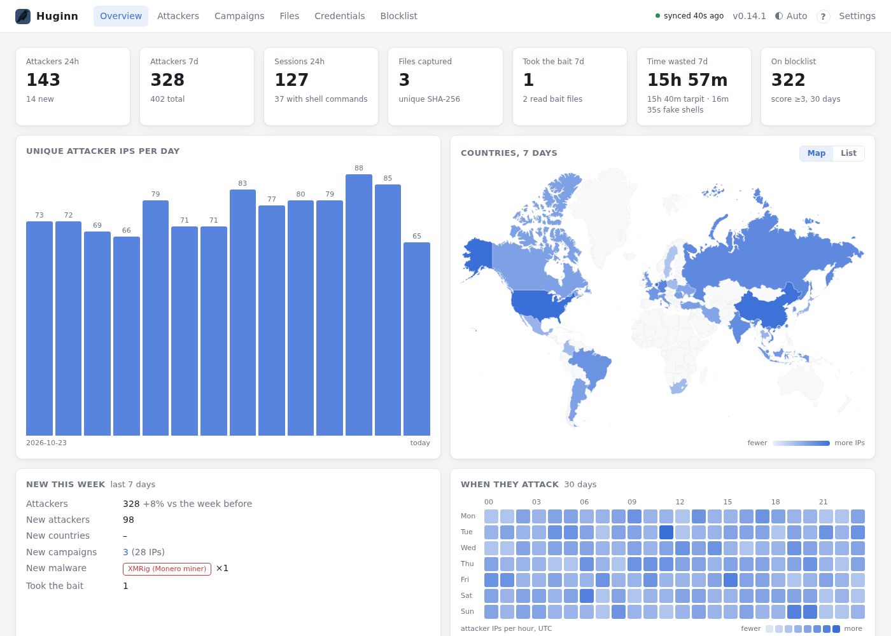
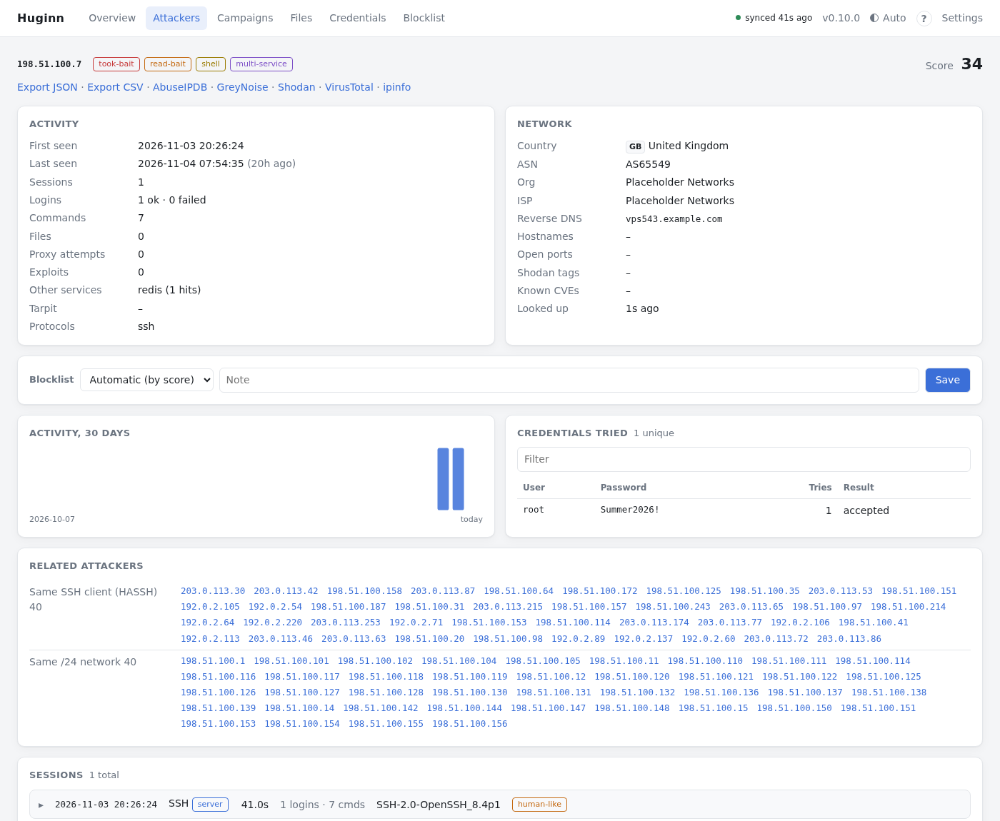
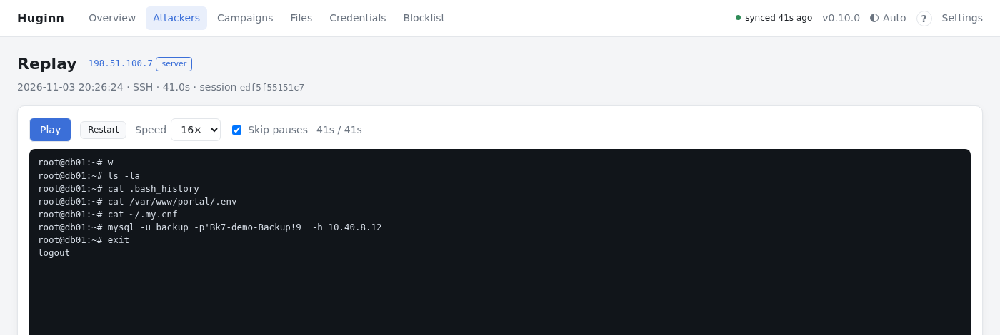
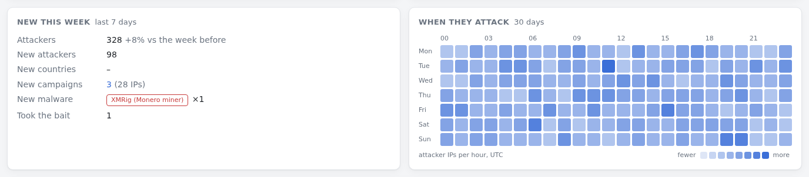
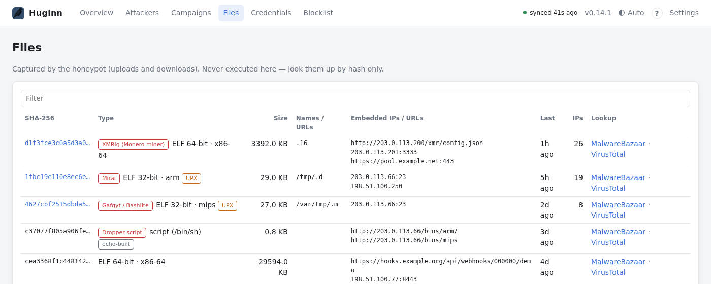
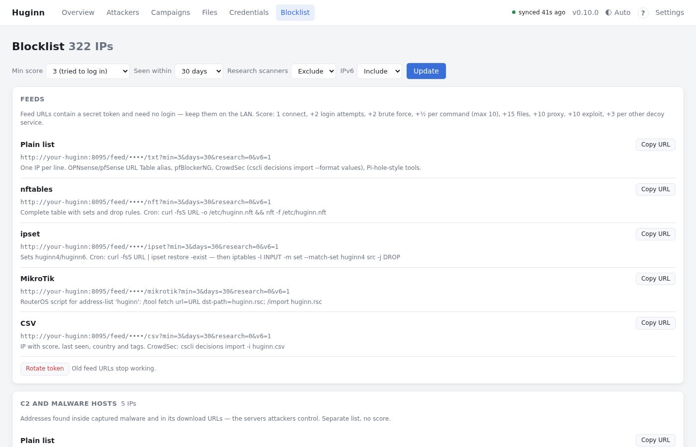

<h1 align="center"></h1>

[](https://github.com/ancientswede/Huginn/actions/workflows/ci.yml)
[](https://buymeacoffee.com/ancientswede)

**Attacker intelligence for a homelab honeypot.** Huginn pulls the logs from your honeypot, keeps the history, shows everything about every attacker IP on its own page, and turns it into blocklists your firewalls can fetch.

**[See the live demo →](https://ancientswede.se/huginn/)** (made-up data, read-only)

*Built with Claude (AI) and run every day on my own honeypot — see [How Huginn is made](#how-huginn-is-made).*

<picture>
  <source media="(prefers-color-scheme: dark)" srcset="docs/screenshots/overview-dark.png">
  
</picture>

In Norse myth Huginn is one of Odin's ravens. It flies out over the world every day and comes back to tell what it saw.

```
                 internet
                    │  port forwards (22, 23, 25, ...)
                    ▼
   ┌───────────────────────────────┐        isolated VLAN, no route to your LAN
   │ Honeypot                      │
   │  Cowrie (fake SSH/Telnet)     │
   │  OpenCanary (fake FTP/HTTP/…) │
   │  endlessh (tarpit)            │
   │  hp-traps (fake mail/DB/proxy)│
   │  hp-export  ◄─────────────────┼──┐  SSH, key locked to one read-only command
   └───────────────────────────────┘  │  (Huginn pulls; the honeypot never connects out)
                                      │
   ┌───────────────────────────────┐  │
   │ Huginn  (your LAN)            │──┘
   │  SQLite history, web UI,      │
   │  blocklist feeds, ntfy alerts │──►  firewalls fetch /feed/<token>/…
   └───────────────────────────────┘
```

## ⚠️ Read this before you open any ports

A honeypot **invites attacks on purpose**. Port forwarding from the internet into your home network is not something to try just to see what happens. Done wrong, you give strangers a way into the network your family's laptops, phones, NAS and cameras live on. **If you are not sure what the steps below mean, stop here and read up first.**

Only open ports when **all** of this is true:

- **The honeypot is truly isolated.** Use its own VLAN (best) or the hypervisor's firewall (see [How to isolate the honeypot](#how-to-isolate-the-honeypot)), so it cannot open connections to your LAN, your router's admin page, your NAS or your other VLANs. A correct port forward alone is not isolation, and neither is a different subnet. **Test it** from the honeypot. Every one of these must fail:
  ```bash
  ping -c1 <a LAN machine>      # must time out
  nc -zv -w3 <your router> 80   # must fail
  nc -zv -w3 <your NAS> 445     # must fail
  ```
- **You forward only to the honeypot**, and only the ports in [Ports to forward](#ports-to-forward). Never forward its admin SSH port. Never forward anything to Huginn: Huginn stays on your LAN or VPN.
- **You keep it up to date.** Patch the honeypot (`apt upgrade`) and Cowrie (`git pull`). Rebuild it if anything looks wrong. Consider blocking its outbound internet once it is installed.
- **You are allowed to.** Some internet providers forbid running servers or block port 25. In many countries, IP addresses are personal data (GDPR), so keep the retention short.
- **You accept the risk.** Huginn comes with **no warranty** (see sections 15–16 of the [license](LICENSE)). You are responsible for your own network.

### How to isolate the honeypot

Getting the port forward right in your router only controls what comes **in**. Isolation is about what a successful attacker can reach **from** the honeypot. Pick one of these:

| | How | Verdict |
|---|---|---|
| **1. Own VLAN** | Put the honeypot on its own VLAN (UniFi, OPNsense, pfSense, MikroTik, most managed switches). Add firewall rules: honeypot VLAN → LAN/other VLANs **and the router itself** = **block**, LAN → honeypot = allow only Huginn to the admin port. | **Best.** The network itself keeps it apart. |
| **2. Hypervisor firewall** | No VLAN-capable gear? Keep the honeypot on your normal network, but block it from your LAN with the firewall of the *host* it runs on (Proxmox example below). Rules inside the honeypot itself do not count: an attacker with root just turns them off. | **Acceptable.** It is still on your LAN segment, so get the rules right and test them. |
| **3. Nothing** | Honeypot on the same network as everything else, only a port forward. | **Don't.** One escape from the fake shell and the attacker is inside your home network. |

**Test it from the honeypot** with `tools/check-isolation.sh`, giving it a few machines from your LAN. It also checks the router itself, which is the most common gap:

```bash
cd Huginn && ./tools/check-isolation.sh 192.168.1.10 192.168.1.20:445 192.168.1.30:8006
```

**UniFi (learned on our own honeypot).**
- **"Isolate Network" is not enough.** It blocks the other VLANs, but the honeypot can still reach the **gateway itself** on all its addresses: its SSH (port 22) answered from the honeypot. Add a firewall policy with the honeypot network as source, the **Gateway** zone as destination and action **Block**, placed before the default "allow to Gateway" policy. Allow DNS (port 53) first only if you want the honeypot to resolve names. It does not need to, and the router's DNS may hand out your internal host names.
- **Give the honeypot a static IP address** in its own network settings (in Proxmox: the container's network device, *Static*). DHCP also goes to the gateway, so once that is blocked the lease cannot be renewed and the honeypot drops off the network. A "Fixed IP" in UniFi is still DHCP.
- **Exclude the honeypot from Threat Management (IPS)**, or it silently drops the attacks. See [Router security features can hide the attacks](#router-security-features-can-hide-the-attacks).
- Run `tools/check-isolation.sh` again after every change.

**Proxmox firewall example (option 2).** Turn on the firewall under Datacenter → Firewall, and on the container's network device (`firewall=1`). Then create `/etc/pve/firewall/<CTID>.fw` on the Proxmox host. Replace `192.168.1.0/24` with your LAN, `192.168.1.50` with Huginn's address and `22022` with your admin port:

```
[OPTIONS]
enable: 1
policy_in: ACCEPT
policy_out: ACCEPT

[RULES]
IN ACCEPT -source 192.168.1.50 -p tcp -dport 22022   # Huginn may pull the export
IN DROP -p tcp -dport 22022                           # nobody else reaches admin SSH
OUT DROP -dest 10.0.0.0/8                              # no private networks at all...
OUT DROP -dest 172.16.0.0/12
OUT DROP -dest 192.168.0.0/16                          # ...including your router's admin page
```

Replies to connections that were made *to* the honeypot still work, because the firewall tracks them. Internet traffic still goes out through your router: it is the router's address as a *destination* that is blocked, not its use as gateway. Give the honeypot a **static IP address** and a public DNS server (for example `1.1.1.1`) instead of your router. With DHCP, the lease renewal to your router would be blocked too, and the honeypot would drop off the network after a while. Then run the isolation test above.

**About the blocklists:**
- They only help where you **apply** them, on the firewall in front of your *real* services.
- They do not make it safe to expose services you could keep private. A VPN (WireGuard and the like) is still the better answer.
- Many attacking addresses are shared or recycled: home routers, CGNAT, cloud servers. Start with a short window (7–30 days), and use "Never block" when a real user gets caught.

## What you get

- **Overview:** attackers per day, top attackers, latest shell sessions, top passwords, countries as a world map or a list (click a country to see its attackers), how many took the bait, and **time wasted** (hours attackers spent stuck in the tarpit and in the fake shells, and who is stuck right now).
- **New:** everything Huginn has never seen before since you last looked: files, scripts, commands, password patterns and SSH clients. Commands and scripts that differ only in addresses, numbers or random markers count as one. Click **Mark all reviewed** when you are done (Undo is one click away).
- **A page per attacker IP:**
  - a one-line summary of what they did, with their sessions first
  - country, network, reverse DNS, open ports and known CVEs (from Shodan InternetDB)
  - every password they tried
  - every session as a terminal log, plus a **replay** that plays the session back exactly as they saw it
  - files they dropped, decoy services they touched and time spent in the tarpit
  - **related attackers** (same SSH client fingerprint, same command script, same file, same /24)
  - an "always block" / "never block" switch
- **Personas:** how far attackers get on each fake machine, where sessions with several lines stop with no download seen, and which single lines hit it. A hint about what may give the honeypot away, not proof.
- **Engagement:** sessions that got in, day by day: what they did after the login (left at once, proxy only, ran commands, went for a payload), how many were typed by hand, the median stay and new against returning attackers. Pick a release to compare the whole days before it with the days after it, to see whether a change to the honeypot kept attackers busier. Also the terminal sizes clients asked for: a bot that asks tends to use one fixed size.
- **Search:** commands, file hashes and names, addresses found inside malware, failed downloads, decoy service data, sessions and attacker IPs across the whole history.
- **Campaigns:** IPs grouped by command script (addresses, numbers and random markers ignored), SSH client fingerprint (HASSH), web attack and mail client name (HELO), so one botnet shows up as one group. **Proxy use** lists what bots fetch through the fake SSH proxy, with a 7-day count of proxy sessions and requests per session to compare before and after a change. **Slow replies** shows how many slow robots exports were sent in full (the client stayed until the last byte) and how long mail sessions lasted.
- **Web attacks:** every request to the web trap is matched against about 3,100 rules from [Krawl](https://github.com/BlessedRebuS/Krawl): CVE exploits (with a link to the CVE), path traversal, webshells, `.env`/`.git` hunting, scanners and probes for exposed MCP servers. Exploits tag the attacker `web-exploit`, probes `web-probe`. A plain GET of a path counts as a probe: it only asks whether the path is there.
- **Files:** everything attackers uploaded or downloaded. Each file is analysed statically on the honeypot: type, CPU architecture, UPX packing, the IP addresses and URLs embedded in it, and **which malware family it looks like** (Mirai, Gafgyt, Mozi, Tsunami, XMRig and other miners, SSH-key backdoors, dropper scripts) from strings these families are known to contain. Nothing is ever executed. Optionally, Huginn looks each file up on [MalwareBazaar](https://bazaar.abuse.ch) by its hash.
- **Credentials:** top usernames, passwords and pairs across SSH, Telnet, FTP, HTTP, MySQL, Redis, SMTP, POP3, IMAP, PostgreSQL and SOCKS5.
  - **Is my password in here?** Check whether attackers have tried one of your own passwords. The check runs in your browser: only the first 4 characters of the password's SHA-256 hash go to Huginn (the same idea as Have I Been Pwned), so the password itself never leaves your machine.
  - Search every username and password, and export them as word lists (for your own password policy or audits) or as a CSV of every attempt.
- **Personas and bait detection:** the installer makes the honeypot look like a real server, file server or IP camera, with fake credentials planted where attackers look. Huginn tags anyone who reads them (`read-bait`) or later tries one of them anywhere (`took-bait`).
- **SSHole detection:** an SSH login with a password of 257-1024 bytes, the shape of a [CVE-2026-123158](https://www.cve.org/CVERecord?id=CVE-2026-123158) attempt, tags the attacker `sshole-probe`. It shows what was tried, not that it would have worked: Cowrie is a fake server, and the bug only affects musl systems such as Alpine.
- **Sync gaps:** the day charts and the Account page show when Huginn did not collect, so a dip in a chart is not mistaken for a quiet day.
- **Blocklists** as plain text, nftables, ipset, MikroTik or CSV, filtered by score and age. There is also a separate **C2 list**: the servers attackers download from and the addresses found inside their malware.
- **New this week** and **When they attack:** what was new in the last seven days (attackers, countries, campaigns, malware, bait), and a heat map of attacker IPs per hour of the week.
- **ntfy alerts:** at most one summary per hour, sent only when something worth a look happened (bait taken, new file, human-like session, exploit attempt, SSHole probe), plus a weekly summary on Sunday evening.
- **Your way:** light, dark or automatic theme, six accent colours, a compact layout, a 12- or 24-hour clock, the columns and overview cards you want, and countries or networks you never want to see (they are still blocklisted). Every attacker can be exported as JSON or CSV. Keyboard shortcuts: press `?`.

Huginn uses only the Python standard library and SQLite. There are no dependencies, no build step and no JavaScript framework. It runs comfortably in a 1 core / 512 MB LXC.

### Screenshots

All from the demo, with made-up data. They follow your light/dark setting.

| A page per attacker | Session replay |
|---|---|
| <picture>  <source media="(prefers-color-scheme: dark)" srcset="docs/screenshots/attacker-dark.png">  </picture> | <picture>  <source media="(prefers-color-scheme: dark)" srcset="docs/screenshots/replay-dark.png">  </picture> |

**New this week and when they attack**

<picture>
  <source media="(prefers-color-scheme: dark)" srcset="docs/screenshots/week-dark.png">
  
</picture>

**Captured malware, with the family it looks like**

<picture>
  <source media="(prefers-color-scheme: dark)" srcset="docs/screenshots/malware-dark.png">
  
</picture>

**Blocklist feeds**

<picture>
  <source media="(prefers-color-scheme: dark)" srcset="docs/screenshots/blocklist-dark.png">
  
</picture>

## Requirements

You need **two machines**, VMs or LXC containers. That is on purpose: the honeypot will be broken into sooner or later. If Huginn, with your history and your blocklists, ran on the same machine, an attacker who escaped the fake shell would get both.

| | Honeypot | Huginn |
|---|---|---|
| OS | Debian 12 or 13 | Debian 12 or 13 |
| CPU / RAM / disk | 1 core, 1–2 GB, 8 GB | 1 core, 512 MB–1 GB, 8 GB |
| Network | **isolated**: own VLAN (best) or blocked from your LAN by the hypervisor firewall, see [How to isolate](#how-to-isolate-the-honeypot); internet ports forwarded to it | your normal LAN |
| Reaches | the internet while installing | the honeypot's admin SSH port |

**Proxmox:** use unprivileged LXC containers from the Debian template, with **nesting enabled** (the default in recent versions). The services use systemd sandboxing, which needs it.

**Outbound internet for the honeypot:** the installer needs it. Afterwards you choose:
- **Blocked** (recommended): attackers' downloads fail, so you only see the URLs they tried.
- **Allowed:** Cowrie captures the malware itself. Never allow traffic to your LAN either way.

## Quick start (about 10 minutes)

Run each script as root from a clone of this repository. Both scripts can be run again safely, and they keep what is already done.

**1. On the honeypot machine**

```bash
apt-get install -y git && git clone https://github.com/ancientswede/Huginn.git && cd Huginn
./install-honeypot.sh
```

The script asks before each optional part: OpenCanary, the endlessh tarpit and hp-traps. Then it:
- Asks which port your own admin SSH should move to (suggests 22022, any free port above 1024 works), and asks you to prove you can log in there **before** port 22 goes to the honeypot, so you cannot lock yourself out.
- Asks what SSH should pretend to be (a **server** or a **file server**) and whether Telnet should be an **IP camera**. Each install gets its own random hostname, network, hardware and planted bait (see [Personas and bait](#personas-and-bait)).
- Installs Cowrie and redirects the public ports to the honeypot services.
- Ends with the list of ports to forward in your router.

From now on, log in with `ssh -p <your admin port> root@honeypot`.

**2. On the Huginn machine** (or use the [Debian package](#install-with-the-debian-package) or [Docker](#run-huginn-in-docker), neither needs a clone)

```bash
apt-get install -y git && git clone https://github.com/ancientswede/Huginn.git && cd Huginn
./install-huginn.sh --honeypot <honeypot IP>     # add --honeypot-port N if you did not use 22022
```

The script:
1. Shows the honeypot's key fingerprint and asks you to compare it.
2. Prints **one line** to run on the honeypot:
   ```bash
   hp-add-huginn-key 'ssh-ed25519 AAAA... huginn@...'
   ```
3. Waits until the honeypot accepts the key, starts Huginn and asks for the password for the web page.

**3. Forward the ports**, but only after you have read [the warning above](#️-read-this-before-you-open-any-ports) and **tested the isolation**. Forward the ports in [Ports to forward](#ports-to-forward) (also listed at the end of step 1) from the internet to the honeypot. Never forward the admin port. Then open `http://<huginn IP>:8095`. The first data shows up within two minutes, after the first sync.

**Test it before you open the ports.** Add `HUGINN_ALLOW_PRIVATE=1` to `/opt/huginn/.env` and run `systemctl restart huginn`. Then attack the honeypot from your own LAN: `ssh root@<honeypot>` and try a few passwords, the fake shell lets you in after 2–5 tries. Your session shows up in Huginn. Remove the line again afterwards, so your own addresses are never recorded. LAN addresses never end up in the blocklists, even in test mode.

## Install with the Debian package

Every [release](https://github.com/ancientswede/Huginn/releases) has a package for the Huginn side, on Debian 12/13 and derivatives. The honeypot is still set up with `install-honeypot.sh`, because each install has to get its own random identity.

```bash
wget https://github.com/ancientswede/Huginn/releases/latest/download/huginn_all.deb
apt install ./huginn_all.deb
huginn-setup                  # asks for the honeypot address, then the same steps as install-huginn.sh
```

- **Update:** download the new package and run `apt install ./huginn_all.deb` again. It backs up first and goes back to the old version by itself if the new one does not start.
- **Go back:** `huginn-rollback`.
- **Remove:** `apt remove huginn` stops Huginn and keeps your settings and data in `/opt/huginn`. `apt purge huginn` deletes them too.
- A machine installed with the scripts can switch by installing the package. Settings and data are kept.

## Run Huginn in Docker

The Huginn side also runs as a container. **The honeypot does not:** it needs its own isolated VM or LXC with port redirects, set up with `install-honeypot.sh` as above. Never run the honeypot next to your other containers.

```bash
mkdir huginn && cd huginn
wget https://github.com/ancientswede/Huginn/releases/latest/download/docker-compose.yml
wget -O .env https://github.com/ancientswede/Huginn/releases/latest/download/huginn.env.example
nano .env                            # set HUGINN_HP_HOST (and HUGINN_HP_PORT if not 22022)
docker compose up -d
docker compose logs huginn           # shows the honeypot's key fingerprint and the line to run on the honeypot
```

1. Compare the fingerprint in the log with `ssh-keygen -lf /etc/ssh/ssh_host_ed25519_key.pub` on the honeypot.
2. On the honeypot, run the `hp-add-huginn-key '...'` line from the log, once.
3. Set the login password: `docker compose exec -it huginn huginn set-password`
4. Open `http://<docker host>:8095`. The first data shows up within two minutes.

Everything Huginn keeps lives in the `huginn-data` volume: the database, session recordings, its SSH key and the honeypot's host key. The container runs as an unprivileged user with a read-only file system and no capabilities.

- **Image:** `ghcr.io/ancientswede/huginn` for amd64 and arm64, built from each release. To build it yourself, clone the repository, use its `docker-compose.yml` and run `docker compose up -d --build`. Pin a version with `HUGINN_TAG=0.13.0` in `.env`.
- **Update:** `docker compose pull && docker compose up -d`. The volume is kept.
- **Extra bait values:** `docker compose cp bait.json huginn:/data/bait.json`, then `docker compose restart huginn`.
- **Honeypot reinstalled** (new host key): `docker compose exec huginn rm /data/.ssh/known_hosts`, then `docker compose restart huginn` and compare the new fingerprint.
- **Back up** the volume, for example: `docker run --rm -v huginn_huginn-data:/data -v "$PWD":/backup alpine tar czf /backup/huginn-data.tgz -C /data .`
- **Remove:** `docker compose down` keeps the data; `docker compose down -v` deletes it too.

## Manual install (what the scripts do)

### 1. On the honeypot

Install Cowrie (and optionally OpenCanary and endlessh) following their own documentation. Then add the export script and its file analyser:

```bash
install -m 755 honeypot/hp-export   /usr/local/bin/hp-export
install -m 755 honeypot/hp-fileinfo /usr/local/bin/hp-fileinfo
```

If your paths differ from the defaults, create `/etc/default/hp-export`. Several Cowrie directories mean several personas:

```bash
COWRIE_DIRS="/home/cowrie/cowrie"
OPENCANARY_LOG="/home/opencanary/opencanary.log"
ENDLESSH_UNIT="endlessh"
TRAPS_LOG_DIR="/var/log/hp-traps"
FILEINFO_USER="cowrie"   # captured files are analysed as this user, never as root
```

Run `hp-export | grep '^##'` once. It should print `##COWRIE ##CANARY ##ENDLESSH ##NFT ##TRAPS ##FILES ##END`.

**Optional: hp-traps.** These are fake mail, database and proxy services. They capture logins and spam-relay attempts and never send or forward anything.

```bash
install -d /opt/hp-traps && install -m 644 honeypot/hp-traps.py /opt/hp-traps/
install -m 644 systemd/hp-traps.service /etc/systemd/system/
systemctl daemon-reload && systemctl enable --now hp-traps
# It listens on 2525 (SMTP), 2587 (submission), 2110 (POP3), 2143 (IMAP), 5432 (PostgreSQL), 1080 (SOCKS5).
# Map the real ports with nftables, for example:
#   tcp dport 25 redirect to :2525 ; tcp dport 587 redirect to :2587
#   tcp dport 110 redirect to :2110 ; tcp dport 143 redirect to :2143
```

**Your admin SSH must not use port 22**, because that is Cowrie's port. Move sshd to another port (for example 22022) before redirecting 22 to Cowrie. On Debian 13, sshd is started through `ssh.socket`, so set the port with a drop-in for `ssh.socket` (`ListenStream=`).

### 2. On the Huginn host

```bash
useradd --system --home-dir /opt/huginn --shell /usr/sbin/nologin huginn
install -d -o huginn -g huginn /opt/huginn/data
install -d -m 700 -o huginn -g huginn /opt/huginn/.ssh
install -m 644 app.py /opt/huginn/app.py
install -m 644 systemd/huginn.service /etc/systemd/system/
cp .env.example /opt/huginn/.env && chmod 600 /opt/huginn/.env   # then edit HUGINN_HP_HOST etc.

# A key that only exists for this
runuser -u huginn -- ssh-keygen -t ed25519 -N "" -C huginn -f /opt/huginn/.ssh/honeypot_ro
cat /opt/huginn/.ssh/honeypot_ro.pub
```

### 3. Lock the key to the export on the honeypot

Add **one line** to `/root/.ssh/authorized_keys` on the honeypot. `restrict` turns off shells, port forwarding and the rest, and `command=` means the key can only run hp-export, whatever the client asks for:

```
restrict,command="/usr/local/bin/hp-export" ssh-ed25519 AAAA...your-key... huginn
```

Then accept the honeypot's host key once and start Huginn:

```bash
runuser -u huginn -- ssh -i /opt/huginn/.ssh/honeypot_ro -p 22022 \
  -o UserKnownHostsFile=/opt/huginn/.ssh/known_hosts root@HONEYPOT | grep -c '^##'   # prints 7
systemctl daemon-reload && systemctl enable --now huginn
runuser -u huginn -- python3 /opt/huginn/app.py set-password
```

Open `http://huginn-host:8095` and log in. The first sync runs within two minutes.

**History from before Huginn:** copy old `cowrie.json.*` and `opencanary.log*` files to the Huginn host and run `runuser -u huginn -- python3 /opt/huginn/app.py import FILE...`. Lines Huginn already has are skipped, so you can run it again at any time, for example after Huginn has been down for a while. The export only covers the latest lines, so a long gap otherwise leaves a hole.

## Notifications (optional)

Huginn can push a short summary to [ntfy](https://ntfy.sh), the phone app, when something worth a look happens: bait taken, new malware, a human-like session or an exploit attempt. It sends at most one message per hour, and nothing at all if this is not set up.

- **During install:** `install-huginn.sh` asks whether you want ntfy, suggests a random topic name and sends a test notification.
- **Later:** add `HUGINN_NTFY_URL` to `/opt/huginn/.env` (and `HUGINN_NTFY_TOKEN` if your server uses access control), then run `systemctl restart huginn`.
- **Choose which events** you get, or send a test, on the **Settings** page.
- **Your own ntfy server** in the homelab is the most private option. On the public `ntfy.sh`, anyone who guesses the topic name can read your messages, so use a long random name like the one the installer suggests. The messages only contain counts and attacker IPs, never your own addresses.

## Ports to forward

Forward these **TCP** ports from the internet to the honeypot, and only the rows for the parts you installed. The installer prints the same list at the end. Inside the honeypot, nftables passes each port on to the service that pretends to be there.

| Public port | Pretends to be | Part | Inside the honeypot |
|---|---|---|---|
| 22 | SSH (server or file-server persona) | Cowrie, always | 2225 |
| 23 | Telnet (IP camera persona) | Cowrie, always | 2323 |
| 2222 | SSH tarpit: keeps scanners stuck for hours | endlessh | 2224 |
| 21 | FTP | OpenCanary | 2121 |
| 80 | Web login page (a NAS) | OpenCanary | 8080 |
| 443 | The same over HTTPS (self-signed, generic name) | OpenCanary | 8443 |
| 8080 | Web, alternative port | OpenCanary | 8080 |
| 3306 | MySQL | OpenCanary | 3306 |
| 5900 | VNC | OpenCanary | 5900 |
| 6379 | Redis | OpenCanary | 6379 |
| 25 | SMTP mail server (open-relay bait, never sends) | hp-traps | 2525 |
| 587 | Mail submission | hp-traps | 2587 |
| 110 | POP3 | hp-traps | 2110 |
| 143 | IMAP | hp-traps | 2143 |
| 5432 | PostgreSQL | hp-traps | 5432 |
| 1080 | SOCKS5 proxy (always refuses) | hp-traps | 1080 |

**Never forward** the honeypot's admin SSH port (22022 by default), and never forward anything to Huginn. Forward a port to the same port number on the honeypot (22 → 22, not 22 → 2225): the redirects inside take care of the rest. Some providers block port 25; the rest still works. All of this is TCP; UDP is not needed.

### Router security features can hide the attacks

Many routers and firewalls inspect incoming traffic and silently drop what looks like an attack: an **IPS** (intrusion prevention), "threat management" or "active protection". For a honeypot, that is exactly the traffic you want. Typical sign: the encrypted or less common ports (443, VNC, MySQL) still get visits, but SSH (22, 2222) and plain HTTP (80, 8080) go quiet, even though the port forwards are right.

**Exclude the honeypot's network (VLAN) or address from the IPS**, or set it to detect only, never block. Leave the IPS on for the rest of your network.

- **UniFi:** Settings → Security → Threat Management: add the honeypot's network or IP as an exclusion. Found out the hard way: with prevention on, the honeypot saw almost no SSH or web attacks.
- **OPNsense / pfSense with Suricata or Snort in blocking mode:** add the honeypot's address to a pass list, or don't run blocking mode on that interface.
- **Others** (Firewalla, consumer routers with "security" or "threat protection" add-ons): look for an exclusion per device or network.

Some routers also have a **built-in honeypot**. It is unrelated to this one and only watches your own networks. Leave it as it is; it does not need to be on the honeypot's VLAN.

To test from outside: turn off Wi-Fi and VPN on your phone and open `http://<your public IP>/`. You should see the fake NAS login page, and the visit shows up in Huginn within two minutes. Then mark your phone's address as "never block" on its Huginn page.

## Updating

Get the new version, then run the update script on each machine. Your settings, keys, login and collected data are never replaced.

```bash
cd Huginn && git pull

# On the Huginn machine
./update-huginn.sh              # backup -> install -> checks the new version answers -> rolls back by itself if not
./update-huginn.sh --rollback   # go back to the version before the last update

# On the honeypot
./update-honeypot.sh                          # hp-export, hp-fileinfo, hp-traps
./update-honeypot.sh --cowrie --opencanary    # also upgrade Cowrie and OpenCanary and re-apply Huginn's patches
```

- `update-huginn.sh` keeps the last three backups (code + a consistent copy of the database) in `/opt/huginn/backups/`, and lists what is new since your version.
- Huginn checks GitHub's public list of version tags once a day and shows **update x.y.z** in the header when there is a newer one. Nothing about you is sent. Turn it off with `HUGINN_UPDATE_CHECK=0`.
- Running the install scripts again also works. They keep everything that is already set up, but they make no backup and do not roll back on failure.

## Database backups

Once a day Huginn saves a compressed copy of its database in `/opt/huginn/data/backups/` and keeps the last 3. Change that with `HUGINN_DB_BACKUPS` (`0` turns it off) and `HUGINN_DB_BACKUP_HOURS`. The first one is made a few minutes after the start.

- Every copy is checked first. If the database is damaged, no copy is saved and the good ones stay. You get a warning on the Account page and through ntfy.
- The copies hold your login hash and feed token, so only Huginn's user can read them.
- They sit on the same disk as the database. They save you from a broken update or a damaged database, not from a dead disk: copy them somewhere else too.

To bring one back:

```bash
systemctl stop huginn
runuser -u huginn -- python3 /opt/huginn/app.py backups
runuser -u huginn -- python3 /opt/huginn/app.py restore-db huginn-20261107-120000.db.gz
systemctl start huginn
```

Add your `HUGINN_BASE` if you changed it. In Docker: `docker compose stop huginn`, then `docker compose run --rm huginn restore-db <name>`, then `docker compose start huginn`.

The restore checks the copy before it touches anything, and keeps the database you had next to it as `huginn.db.before-restore-...`. Events after the copy are lost, except those still in the honeypot's export: they come back at the next sync.

## Using the blocklists

The ipset and MikroTik feeds also clear the IPv6 list, so an address that left the blocklist is removed. A firewall without IPv6 support should fetch the feed with `v6=0`. Addresses an earlier feed added to an IPv6 list then have to be removed by hand.

The **Blocklist** page builds feed URLs from your filters (minimum score, how recently seen, include research scanners or not). The feed URLs contain a secret token instead of a login, so firewalls can fetch them. Keep them on your LAN. You can rotate the token on the page.

| Format | Use with |
|---|---|
| `txt` | OPNsense/pfSense URL Table alias, pfBlockerNG, `cscli decisions import --format values` (CrowdSec) |
| `nft` | `curl -fsS URL -o /etc/huginn.nft && nft -f /etc/huginn.nft` (complete table with drop rules) |
| `ipset` | `curl -fsS URL \| ipset restore -exist`, then `iptables -I INPUT -m set --match-set huginn4 src -j DROP` |
| `mikrotik` | `/tool fetch url=URL dst-path=huginn.rsc; /import huginn.rsc` |
| `csv` | IP with score, last seen, country and tags (CrowdSec `cscli decisions import -i`) |
| `c2` | Malware download hosts and addresses embedded in captured malware, seen from at least 2 attackers. Attackers can choose these addresses, so use it as advice, not as an automatic block |

**Score:**
- connection: 1
- tried to log in: +2
- brute force: +2
- per command: +½, up to 10
- dropped a file: +15
- used the honeypot as a proxy: +10
- exploit attempt: +10
- SSHole probe: +10
- each other decoy service: +3
- read bait: +5
- took bait: +20

**Before you block anything:**
- Most attackers are infected home routers and cheap VPSs whose addresses change hands. That is why the feeds only include IPs seen in the last N days.
- Research scanners (Censys, Shadowserver, BinaryEdge and others) are detected from reverse DNS and network names and left out by default. Anyone who logged in, ran commands, dropped files or tried an exploit is always blocklisted, research network or not.
- "Never block" always wins.

## Personas and bait

Attackers stay longer, and show more of what they want, on a machine that looks real and worth something. `install-honeypot.sh` sets this up for you:

| Persona | Port | Looks like | Bait planted in |
|---|---|---|---|
| `server` | SSH 22 | Ubuntu server with a web app, MySQL, Redis and backups to S3 | `.bash_history`, `.my.cnf`, `.aws/credentials`, the app's `.env`, `backup.sh` |
| `nas` | SSH 22 | Debian file server with Samba, rsync and Nextcloud | `.bash_history`, `.smbcredentials`, `rsyncd.secrets`, `rclone.conf`, Nextcloud's `config.php` |
| `camera` | Telnet 23 | Cheap ARM IP camera | `Account1`, `network.conf`, `wpa_supplicant.conf` |

- **Different on every install.** The hostname, internal network, users, CPU, memory, kernel and every bait value are random, so two Huginn honeypots never look alike, and nobody can recognise them all by one fixed detail.
- **Consistent.** `hostname`, `uname`, `nproc`, `lscpu`, `/proc/cpuinfo`, `free`, `/etc/passwd` and the home folders tell the same story. Cowrie's `free` normally shows the *real* machine's memory; Huginn patches it.
- **Realistic logins.** Attackers get in after 2–5 tries (Cowrie's `AuthRandom`), and the honeypot remembers each IP's password.
- **A proxy that seems to work.** Many bots log in only to use the box as an SSH proxy and test it first (`GET yahoo.com/`, `google.com`, `yandex.ru`). Plain Cowrie refuses, so they leave. Huginn patches Cowrie to answer such a plain HTTP check with an empty `200` page and to hold TLS silently for up to 30 s (at most 64 at a time). **Nothing is ever forwarded or connected**; anything else is refused as before. The attacker page and Campaigns › Proxy use show what was answered.
- **Uploaded programs "run".** A program uploaded for the persona's CPU exits silently instead of failing with "Exec format error", so bots go on to their next step; the run, its arguments and the file's hash are logged. Nothing is ever executed (`patches.py cowrie-exec`). `wget` prints what the persona's own wget would: BusyBox text on the camera, and no "connected" before a connection fails (`cowrie-wget`).
- **Timeline and ATT&CK.** The attacker page opens with a timeline of the last 30 days across every service, one step per kind of activity, each with a phase. Commands are labelled with MITRE ATT&CK techniques (simple patterns: what a command tried, not proof that it worked).
- **Protection report.** The export lists the honeypot's own protection (sandbox and memory/file limits per service, running services, every Huginn patch). Account shows it, and Huginn alerts when something goes missing.
- **Collection health.** Huginn alerts (ntfy) when no sync has worked for 30 minutes or a source is quiet for longer than its own longest silence last week, and again when it is back. Account lists every source with its newest data; `/healthz` adds `collection_problems`.
- **Repeated tries are counted, not all stored.** Decoy services keep the first 2,000 events per IP, service and day (`HUGINN_DECOY_CAP`, 0 keeps everything); the rest are only counted, so scores and totals stay right. Account shows how fast the data folder grows and when the disk would be full.
- **Two Cowrie fixes.** Cowrie's `ping` never accepted `-c N`, so the usual network check `ping -c 1 8.8.8.8` failed and most telnet bots left there. And a file uploaded over SFTP or `scp` vanished before the next command, so the bot's `chmod +x` failed and it never ran the file. Huginn patches both (`patches.py cowrie-ping`, `cowrie-upload`); an uploaded file now stays for the whole connection. Uploads are capped at 10 MB, and `setup-sandbox.sh` gives Cowrie and OpenCanary a memory cap and a 128 MB limit per file, so one huge upload cannot fill the disk or take the honeypot down.
- **Slow replies.** The fake mail server waits 1 to 2.5 s before it says a message is queued. The message is already logged by then, so nothing is lost. A session takes at most 50 messages and 10 minutes, and mail may use at most half of hp-traps' connections. The web trap sends the robots-only backup file in small parts over about 5 s (at most 32 at a time, 2 per IP). The `.env` file and other first replies stay fast. Both log how the visit ended, and Campaigns › Slow replies sums up the last 7 days.
- **Bait detection works by itself.** The honeypot tells Huginn its personas and bait values through the export. Huginn tags anyone who reads a bait file (`read-bait`) and anyone who later uses one of the values anywhere, on any service (`took-bait`).

Everything lives in `/etc/huginn-honeypot/` on the honeypot (root only). **Never publish it**: it is exactly what would let someone recognise your honeypot. Want a new identity? Delete that folder and Cowrie's `etc/cowrie.cfg`, then run the installer again.

You can still build your own: put files in a Cowrie instance's `honeyfs`, add them with `honeypot/personas.py fs`, and list extra bait values in `bait.json` next to `app.py` (see `examples/bait.example.json`). Set `HUGINN_PERSONAS` to override the persona names the honeypot announces.

## The web trap's identity

Ports 80 and 443 pretend to be a NAS or a router, and change by themselves every few weeks. `hp-identity` on the honeypot picks from 19 devices (8 NAS brands, 11 routers) and changes the login page, the `Server` header and the certificate together. Only OpenCanary restarts; the SSH and telnet personas are not touched.

```bash
hp-identity list              # the devices it can pretend to be
hp-identity status            # what it is now
hp-identity set mikrotik      # change now (or: set random)
```

`ROTATE_DAYS=21` in `/etc/default/hp-identity` sets how often it changes, `0` turns it off. Do not make it very short: a machine that keeps changing what it is on one address looks odd by itself, and scanners keep history. The login pages are written from scratch for Huginn, with product names as plain text and no logos or code from any vendor.

**Fake replies.** For the files scanners hunt most, the trap answers 200 with believable fake content instead of 404: `.env` and its variants, `.git/config` and `HEAD`, `.aws/credentials` and `config`, phpinfo, `/etc/passwd` through path traversal, PHPUnit's `eval-stdin.php`, Spring `/actuator/env` and MCP servers (`/mcp`, `/sse`, with `initialize` and `tools/list`). Every secret in them is a bait value from `/etc/huginn-honeypot/bait.json`, the same for every request, so Huginn tags anyone who later uses one `took-bait`, and the request itself `read-bait`. Without a `bait.json` the trap answers 404 as before. Replies are plain text or JSON, small, and sent with a sandboxing `Content-Security-Policy`.

**robots.txt trap.** Each identity gets a `robots.txt` with four `Disallow:` paths that exist nowhere else and stay the same for that identity. Only someone who reads robots.txt and goes looking finds them; Huginn tags them `robots-trap` (+5).

Huginn only reads the history (through `hp-export`) and shows it on **Personas**: hits per day for each device, since each one runs for a different time. It cannot change the identity: nothing ever connects to the honeypot to control it.

## Configuration

All settings are environment variables in `/opt/huginn/.env`. See [`.env.example`](.env.example).

| Variable | Default | Meaning |
|---|---|---|
| `HUGINN_HP_HOST` | – | Honeypot address (required) |
| `HUGINN_HP_PORT` | `22022` | Honeypot admin SSH port |
| `HUGINN_PORT` / `HUGINN_BIND` | `8095` / `0.0.0.0` | Web UI |
| `HUGINN_TZ` | `UTC` | Time zone for the UI and per-day charts |
| `HUGINN_POLL` | `120` | Seconds between syncs |
| `HUGINN_RETENTION_DAYS` | `180` | Days of history kept; `0` keeps everything forever |
| `HUGINN_DECOY_CAP` | `2000` | Decoy-service events stored per IP, service and day; the rest are only counted. `0` stores everything |
| `HUGINN_DB_BACKUPS` | `3` | Automatic copies of the database to keep; `0` turns them off |
| `HUGINN_DB_BACKUP_HOURS` | `24` | Hours between those copies |
| `HUGINN_ENRICH` | `1` | Look up attacker IPs at ipwho.is and Shodan InternetDB |
| `HUGINN_PERSONAS` | announced by the honeypot | `port=name,...` for several Cowrie instances |
| `HUGINN_MALWAREBAZAAR_KEY` | – | Look captured files up on MalwareBazaar by SHA-256 (only the hash is sent). Free key at [auth.abuse.ch](https://auth.abuse.ch) |
| `HUGINN_VIRUSTOTAL_KEY` | – | VirusTotal verdicts for captured files: how many engines flag a file, or *novel* if VirusTotal has never seen it (only the SHA-256 is sent). Can also be pasted on the Settings page, where it is tested and never shown again. Free key at [virustotal.com](https://www.virustotal.com) |
| `HUGINN_VIRUSTOTAL_DAILY` | `400` | Most VirusTotal lookups a day (the free key allows 500, and 4 a minute) |
| `HUGINN_GREYNOISE_DAILY` | `40` | Most GreyNoise community lookups a day, top attackers first; `0` = off. Benign mass scanners count as research unless they logged in or ran something |
| `HUGINN_GREYNOISE_KEY` | – | Optional free GreyNoise key for a larger allowance |
| `HUGINN_C2_EXCLUDE` | (empty) | Addresses that never go on the C2 list, separated by commas (your DNS, VPN, ...) |
| `HUGINN_ALLOWED_HOSTS` | (empty) | Host names the web page answers to, separated by commas, with the port if it is not 80/443 (`huginn.lan:8095`). Empty = any. Stops DNS rebinding |
| `HUGINN_BAIT_FILE` | `/opt/huginn/bait.json` | Extra bait values to watch for (the honeypot's own are announced) |
| `HUGINN_NTFY_URL` / `HUGINN_PUBLIC_URL` | – | ntfy topic URL and the link in notifications |
| `HUGINN_NTFY_TOKEN` | – | Access token (`tk_...`) for an ntfy server with access control |
| `HUGINN_TRUSTED_PROXIES` | – | Reverse proxy IPs allowed to set `X-Forwarded-*` |
| `HUGINN_MASK` | – | Your own public IPs/domains, replaced with `[self]` in everything stored (attackers often echo the address they target) |
| `HUGINN_UPDATE_CHECK` | `1` | Daily check for a newer version (reads GitHub's public tag list) |
| `HUGINN_ALLOW_PRIVATE` | `0` | `1` = also record LAN source addresses (testing only; never blocklisted) |

## Security model

- **The honeypot stays isolated.** Huginn connects *to* the honeypot. The honeypot needs no route to your LAN, and the key can only print logs. If the honeypot is ever fully compromised, the attacker gets that log export and nothing else.
- **Attacker data is untrusted.** Everything attackers typed is escaped. The UI has a strict Content-Security-Policy (no inline scripts).
- **Logins:** one password (scrypt), HttpOnly SameSite=Strict cookies, at most 5 failed logins per 15 minutes per IP, same-origin checks on every form.
- **Do not expose Huginn to the internet.** Keep it on your LAN or VPN, or behind a reverse proxy with an IP allow-list.
- **Captured files never leave the honeypot.** Only their analysis (type, architecture, embedded IPs and URLs) is exported.
- **Enrichment** sends attacker IPs, and nothing else, to ipwho.is and internetdb.shodan.io. Set `HUGINN_ENRICH=0` to turn it off.

**Privacy:** IP addresses count as personal data in many jurisdictions, also when they belong to attackers. Huginn deletes history older than `HUGINN_RETENTION_DAYS` (unless you set it to `0`). Pick a retention you can justify.

## Logs and disk space

The honeypot only needs a short history; Huginn keeps the long one.

**On the honeypot** (small disk, lots of logs), `hp-logclean` runs every night:

| What | Kept on the honeypot | Setting in `/etc/default/hp-export` |
|---|---|---|
| Cowrie's logs | gzipped after a day, deleted after 30 days | `LOG_KEEP_DAYS` |
| Session recordings | 30 days | `TTY_KEEP_DAYS` |
| Captured files (malware) | forever | `DOWNLOAD_KEEP_DAYS` (`0` = keep) |
| OpenCanary's log | logrotate: daily, compressed, 30 days | `/etc/logrotate.d/opencanary` |
| hp-traps' logs | 30 days (cleans up itself) | – |
| systemd journal (endlessh) | at most 200 MB | `/etc/systemd/journald.conf.d/huginn-honeypot.conf` |

`hp-logclean -n` shows what it would do. Huginn syncs every two minutes, so it has everything long before the honeypot deletes it.

**In Huginn**, everything lives in one SQLite database (`/opt/huginn/data/huginn.db`): events, sessions, credentials, files, enrichment. Session recordings are copied over in the background and kept compressed in `/opt/huginn/data/tty`, so replays keep working after the honeypot has deleted its copy. History older than `HUGINN_RETENTION_DAYS` (180 by default) is deleted; set it to `0` to keep everything. The Account page shows the database size, the recordings and the free disk space. Expect roughly 5–20 MB of database per day on a busy honeypot, most of it SSH password guessing; repeated decoy tries above `HUGINN_DECOY_CAP` are counted, not stored. Account also shows how fast the data folder grows and when the disk would be full.

`update-huginn.sh` keeps the last three versions of the code but only one database copy (the newest), so updates do not eat the disk as the database grows.

## Uninstall

Run from the repository folder as root. Both scripts ask you to type `remove` first (`--yes` skips that).

```bash
# Huginn machine: the database is kept in /root/huginn-data-<date> unless you add --purge
./uninstall-huginn.sh [--purge]

# Honeypot: port redirects go first, then the services, the export, Huginn's key and the personas/bait
./uninstall-honeypot.sh [--purge] [--restore-ssh]
```

- `--purge` on the honeypot also deletes Cowrie, OpenCanary, their users, all logs and captured files, and the endlessh package (only if the installer set it up).
- `--restore-ssh` puts your admin SSH back on port 22 only. Without it, both 22 and your admin port reach the real sshd.
- You can run the honeypot script again later with `--purge` or `--restore-ssh`.
- Not removed: the Debian packages the installer added (git, python3-venv, build-essential, …), which other software may use, and the backups of `/etc/nftables.conf` it made.
- Delete the port forwards in your router, and the jobs on your firewalls that fetch Huginn's blocklists.

## Try it without a honeypot

`tools/make_demo.py` builds a static, read-only copy of Huginn with made-up data. Every address, network and AS number comes from the ranges reserved for documentation, so none of it belongs to anyone real:

```bash
python3 tools/make_demo.py ./demo --base /
cd demo && python3 -m http.server 8000   # then open http://127.0.0.1:8000/
```

## Commands

```
app.py serve                 # run the web UI and the collector (what systemd runs)
app.py set-password          # set or reset the login password (logs out every session)
app.py ingest-once           # one sync, for testing
app.py import FILE...        # import full cowrie.json* / opencanary.log* files

./update-huginn.sh [--rollback]          # update / go back (Huginn machine)
./update-honeypot.sh [--cowrie] [--opencanary]   # update the honeypot side
./uninstall-huginn.sh [--purge]                  # remove Huginn (keeps the data unless --purge)
./uninstall-honeypot.sh [--purge] [--restore-ssh]   # remove the honeypot side
```

## How Huginn is made

Huginn is written with [Claude](https://claude.ai), Anthropic's AI, using Claude Code. I (Ancientswede) decide what it should do, run it on my own honeypot every day and report what breaks or looks wrong. Claude writes the code, the tests and the documentation, and the commits say so (`Co-Authored-By: Claude`).

Nothing is released before it has run on my own honeypot and Huginn, and it is tested end to end on fresh test machines for the install, update, uninstall and Docker paths. Even so, this is a security tool that faces the internet, so:

- **Read before you trust it.** Huginn is small on purpose: one Python file with only the standard library, a few shell scripts, 70+ tests and CI on every change. The [Security model](#security-model) explains what can reach what.
- **Bugs and ideas** are welcome as issues. Security problems: please report them privately (see [SECURITY.md](SECURITY.md)).

## Support

If Huginn is useful in your homelab, you can [buy me a coffee](https://buymeacoffee.com/ancientswede). ☕

## License

Copyright © 2026 Ancientswede. Licensed under [AGPL-3.0-or-later](LICENSE). The web attack rules in `static/web-rules.json.gz` are converted (by `tools/krawl-rules.py`) from the YARA rules of [Krawl](https://github.com/BlessedRebuS/Krawl) by Patrick Di Fazio, licensed under MIT (see `static/web-rules.LICENSE`). The world map in `static/world-map.json` is a simplified version of [@svg-maps/world](https://github.com/VictorCazanave/svg-maps) by Victor Cazanave, licensed under [CC BY 4.0](https://creativecommons.org/licenses/by/4.0/) (see `static/world-map.LICENSE.md`).

The raven logo and the banner were made for this project with Grok Imagine and are shared under the same license.

You may use, change and share Huginn. If you share a modified version, or run one as a service for others, you must publish your changes under the same license and keep the copyright notice (the footer on every page counts as one).
