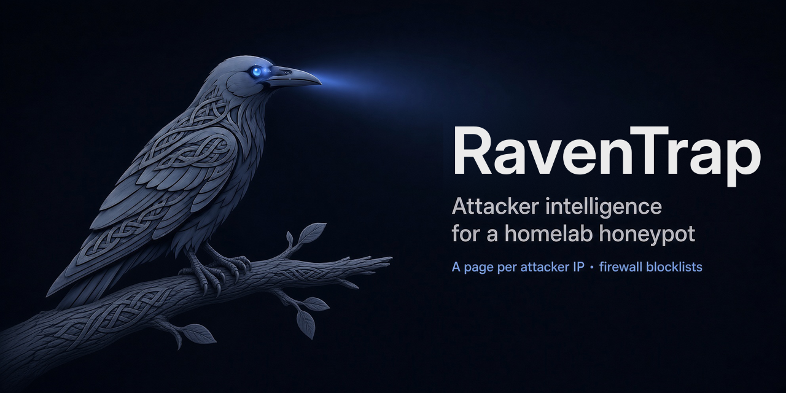
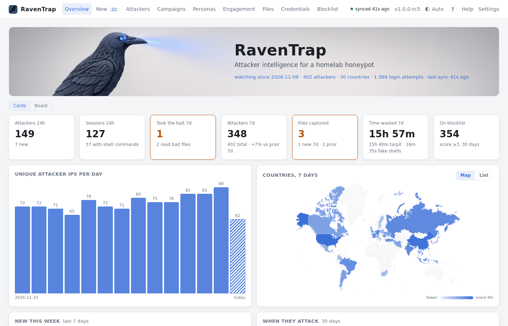

<h1 align="center"></h1>

[](https://github.com/ancientswede/Huginn/actions/workflows/ci.yml)
[](https://buymeacoffee.com/ancientswede)

**Attacker intelligence for a homelab honeypot.** Huginn pulls the logs from your honeypot, keeps the history, shows everything about every attacker IP on its own page, and turns it into blocklists your firewalls can fetch.

**[See the live demo →](https://ancientswede.se/huginn/)** (made-up data, read-only)

*Built with Claude (AI) and run every day on my own honeypot — see [How Huginn is made](#how-huginn-is-made).*

<picture>
  <source media="(prefers-color-scheme: dark)" srcset="docs/screenshots/overview-dark.png">
  
</picture>

In Norse myth Huginn is one of Odin's ravens. It flies out over the world every day and comes back to tell what it saw.

```
                 internet
                    │  port forwards (22, 23, 25, ...)
                    ▼
   ┌───────────────────────────────┐        isolated VLAN, no route to your LAN
   │ Honeypot                      │
   │  Cowrie (fake SSH/Telnet)     │
   │  OpenCanary (fake FTP/HTTP/…) │
   │  endlessh (tarpit)            │
   │  hp-traps (fake mail/DB/proxy)│
   │  hp-export  ◄─────────────────┼──┐  SSH, key locked to one read-only command
   └───────────────────────────────┘  │  (Huginn pulls; the honeypot never connects out)
                                      │
   ┌───────────────────────────────┐  │
   │ Huginn  (your LAN)            │──┘
   │  SQLite history, web UI,      │
   │  blocklist feeds, ntfy alerts │──►  firewalls fetch /feed/<token>/…
   └───────────────────────────────┘
```

## ⚠️ Before you open any ports

A honeypot **invites attacks on purpose**. Done wrong, a port forward gives strangers a way into the network your family's laptops, phones and NAS live on. Put the honeypot on its **own VLAN** (or block it from your LAN with the hypervisor's firewall), test that it cannot reach anything, and never forward anything to Huginn itself.

**Read [Before you open any ports](docs/isolation.md) first.** It shows how to isolate the honeypot and how to test it.

## What you get

- **A page per attacker IP:** what they did, every password tried, sessions as terminal logs with **replay**, dropped files, decoy services touched, related attackers, and lookups (GreyNoise, DroneBL, Spamhaus, Project Honey Pot, Tor, netblock and abuse contact).
- **Blocklists** for your firewalls: plain text, nftables, ipset, MikroTik or CSV, filtered by score and age, plus a separate C2 list.
- **Captured malware** analysed statically (type, architecture, embedded addresses, which family it looks like), never executed.
- **Campaigns:** one botnet shows up as one group, by command script, SSH client, web attack or IDS rule.
- **A honeypot that looks real:** personas with planted bait, and a tag for anyone who reads or uses it.
- **Credentials, search, engagement and "new this week"** across the whole history.
- **Alerts and monitoring:** ntfy, a Prometheus endpoint with a [Grafana dashboard](https://grafana.com/grafana/dashboards/26093-huginn/), and JSON logs. All optional.
- **Small:** Python standard library and SQLite only. No dependencies, no build step. Runs in a 1 core / 512 MB LXC.

The full list, with screenshots: [What Huginn does](docs/features.md).

## Quick start

You need **two machines** (VMs or LXC containers, Debian 12 or 13): an isolated one for the honeypot, and one on your LAN for Huginn.

```bash
# 1. On the honeypot
apt-get install -y git && git clone https://github.com/ancientswede/Huginn.git && cd Huginn
./install-honeypot.sh

# 2. On the Huginn machine
apt-get install -y git && git clone https://github.com/ancientswede/Huginn.git && cd Huginn
./install-huginn.sh --honeypot <honeypot IP>
```

3. Test the isolation, then forward the ports the installer lists to the honeypot.
4. Open `http://<huginn IP>:8095`. The first data shows up within two minutes.

Huginn also comes as a **Debian package** and a **Docker image**. All of it, step by step: [Install](docs/install.md).

## Documentation

| Page | What is in it |
|---|---|
| [Before you open any ports](docs/isolation.md) | Isolating the honeypot, VLAN and Proxmox examples, how to test it |
| [What Huginn does](docs/features.md) | Every page and feature, with screenshots |
| [Install](docs/install.md) | Requirements, quick start, Debian package, Docker, manual install, ports to forward |
| [Personas, bait and the web trap](docs/honeypot.md) | How the honeypot looks real, and how Huginn sees who takes the bait |
| [Using the blocklists](docs/blocklists.md) | Feed formats, firewall examples, the score |
| [Notifications, IDS, DNS and metrics](docs/integrations.md) | ntfy, Suricata, your own DNS resolver, Prometheus/Grafana, JSON logs |
| [Running Huginn](docs/operations.md) | Updating, database backups, logs and disk space, uninstall, demo, commands |
| [Configuration](docs/configuration.md) | Every setting in `.env` |
| [Security model](docs/security.md) | What can reach what, what is sent where, privacy |
| [Stability promise](docs/stability.md) | What stays the same through all 1.x releases |

**Try it first:** the [live demo](https://ancientswede.se/huginn/) runs on made-up data, or build it yourself with `tools/make_demo.py` (see [Running Huginn](docs/operations.md#try-it-without-a-honeypot)).

## How Huginn is made

Huginn is written with [Claude](https://claude.ai), Anthropic's AI, using Claude Code. I (Ancientswede) decide what it should do, run it on my own honeypot every day and report what breaks or looks wrong. Claude writes the code, the tests and the documentation, and the commits say so (`Co-Authored-By: Claude`).

Nothing is released before it has run on my own honeypot and Huginn, and it is tested end to end on fresh test machines for the install, update, uninstall and Docker paths. Even so, this is a security tool that faces the internet, so:

- **Read before you trust it.** Huginn is small on purpose: one Python file with only the standard library, a few shell scripts, 700+ tests, an upgrade test from old releases and CI on every change. The [Security model](docs/security.md) explains what can reach what.
- **Bugs and ideas** are welcome as issues. Security problems: please report them privately (see [SECURITY.md](SECURITY.md)).

## Stability promise

From 1.0.0 the blocklist feeds, exports, `/healthz`, `/metrics` and the settings in `.env` keep working the same way through all 1.x releases. Details: [Stability promise](docs/stability.md).

## Support

If Huginn is useful in your homelab, you can [buy me a coffee](https://buymeacoffee.com/ancientswede). ☕

## License

Copyright © 2026 Ancientswede. Licensed under [AGPL-3.0-or-later](LICENSE). The web attack rules in `static/web-rules.json.gz` are converted (by `tools/krawl-rules.py`) from the YARA rules of [Krawl](https://github.com/BlessedRebuS/Krawl) by Patrick Di Fazio, licensed under MIT (see `static/web-rules.LICENSE`). The world map in `static/world-map.json` is a simplified version of [@svg-maps/world](https://github.com/VictorCazanave/svg-maps) by Victor Cazanave, licensed under [CC BY 4.0](https://creativecommons.org/licenses/by/4.0/) (see `static/world-map.LICENSE.md`).

The raven logo and the banner were made for this project with Grok Imagine and are shared under the same license.

You may use, change and share Huginn. If you share a modified version, or run one as a service for others, you must publish your changes under the same license and keep the copyright notice (the footer on every page counts as one).
